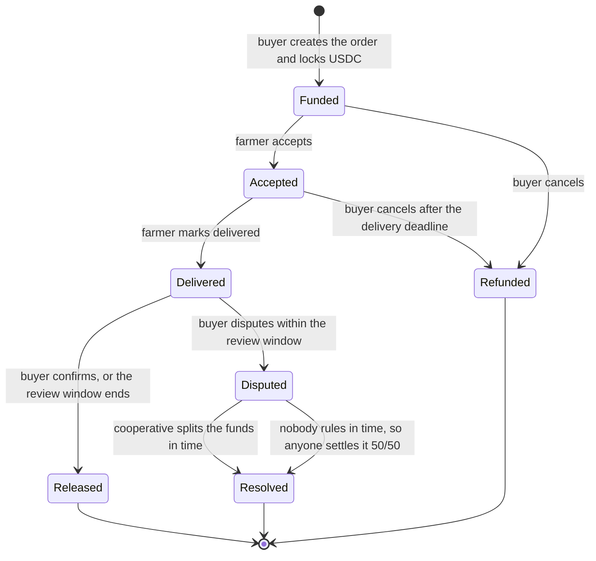
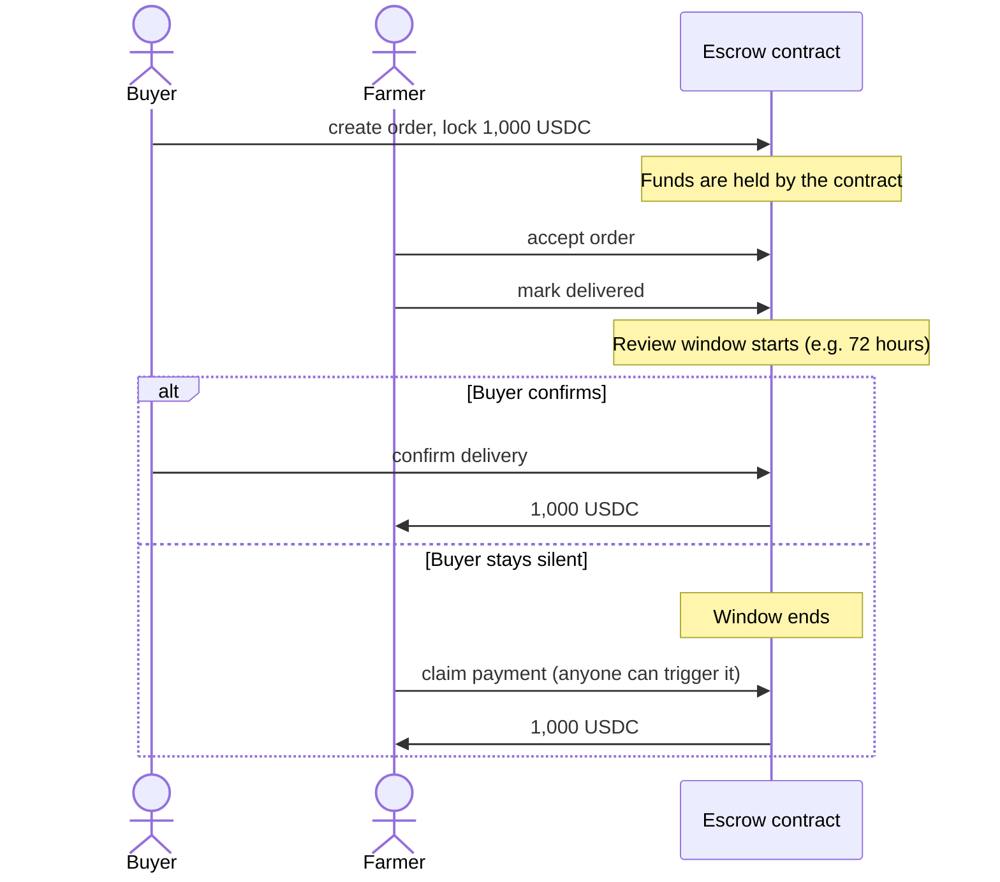
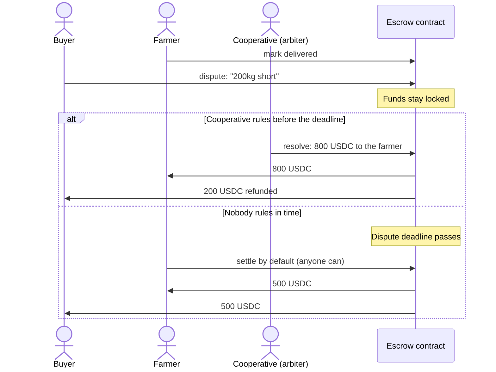
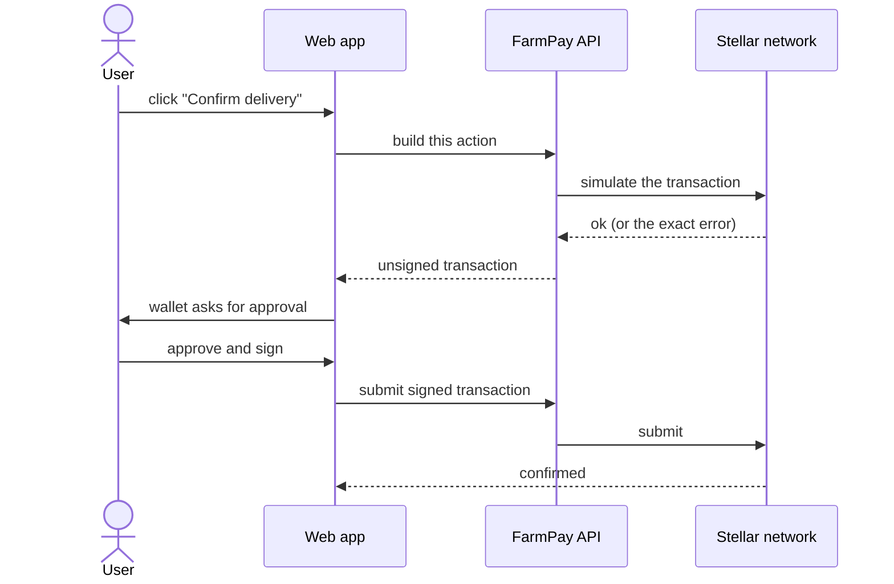

# How FarmPay works

A visual walkthrough of an order, what each person can do, and what happens when things go wrong. For exact rules and error codes, see the [contract specification](../contracts/escrow/README.md).

## The people involved

| Role | Who | What they can do |
|---|---|---|
| **Buyer** | Wholesaler, processor or exporter | Create and fund an order, confirm delivery, dispute, cancel |
| **Farmer** | The seller | Accept an order, mark it delivered, claim payment |
| **Cooperative** | The arbiter, named on every order | Settle a dispute by splitting the funds |
| **Anyone** | Any Stellar account | Release payment to the farmer once the review window has passed |

FarmPay itself holds no funds and no keys. The escrow contract holds the USDC, and each person signs their own steps in their own wallet.

## An order's life

`Released`, `Refunded` and `Resolved` are final. Once an order reaches one of them, the money has moved and nothing more can happen.

## The normal case

## When there's a disagreement

The cooperative can pay the farmer anything from 0% to 100% of the order, and the rest goes back to the buyer. It can only act on a disputed order, and never for more than the order amount.

## How signing works

The FarmPay server never sees a private key. Every action is a two-step handoff:

The simulation step means an action that isn't allowed, such as disputing after the window closed, fails *before* anyone is asked to sign.

## "What if…?"

**…the buyer never confirms?**
The farmer is still paid. Once the review window ends, anyone can release the payment to the farmer.

**…the farmer never accepts?**
The buyer cancels at any time before acceptance and gets a full refund.

**…the farmer accepts but never delivers?**
After the delivery deadline, the buyer can cancel and get a full refund.

**…the buyer and farmer disagree?**
The buyer opens a dispute inside the review window, and the cooperative decides the split before the dispute deadline (the buyer chooses 1 to 30 days when creating the order).

**…the buyer waits until the window has closed to dispute?**
Too late. The contract rejects the dispute and the farmer can claim payment. This is what stops a buyer from holding a farmer's payment hostage.

**…the cooperative never resolves a dispute?**
The money is not stuck. Once the dispute deadline passes, the cooperative can no longer rule and **anyone** (the buyer, the farmer, or a stranger paying the fee) can settle the order. The funds are split evenly, and an odd last unit goes to the buyer. A split is the default because refunding the buyer would let a dishonest buyer dispute a good delivery and keep the goods, while paying the farmer would punish a buyer with a real problem. Splitting limits either side's loss to half, so both want the cooperative to act. The reasoning is in the [contract spec](../contracts/escrow/README.md#why-disputes-have-a-deadline-and-why-the-default-is-a-split).

**…the cooperative is biased?**
Both sides see the arbiter's address before any money moves, and the buyer picks it when creating the order, so a farmer who doesn't trust the named cooperative can simply decline to accept. Beyond that, the arbiter is a trusted role in this version.

## Known limitations

These are real, and they're on the roadmap:

- **The arbiter is trusted** while its dispute window is open. There is no appeal and no multi-party arbitration. If it stays silent, the even split applies; it is not a ruling on who was right.
- **Buyers must pre-fund the whole amount**, which suits buyers who already pay on delivery better than buyers who rely on supplier credit.
- **Farmers need a Stellar wallet.** Cash-out to local bank or mobile money isn't built yet.
